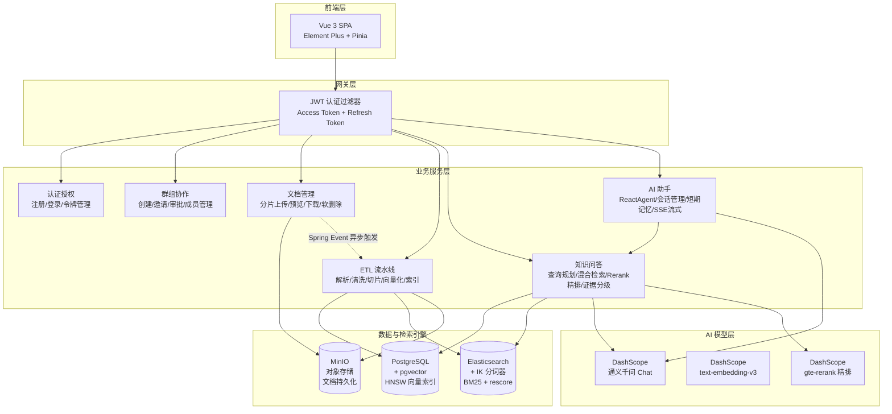

<div align="center">


<br/>
<br/>

# Pharos

**知识库智能问答系统 · 让每一次提问都有据可查**

从文档上传到带引用的回答，一条完整的检索增强生成（RAG）链路

<br/>

[项目简介](#项目简介) ·
[界面预览](#界面预览) ·
[核心技术链路](#核心技术链路) ·
[系统架构](#系统架构) ·
[功能概览](#功能概览) ·
[技术选型](#技术选型) ·
[快速开始](#快速开始) ·
[API 概览](#api-概览) ·
[版本演进](#版本演进)

</div>

---

## 项目简介

**Pharos** 是一个面向企业私有文档的知识库问答系统 —— 把散落在 PDF、Word、Markdown 里的知识，变成**可被检索、可被引用、可被追问**的答案。

它不是对通用大模型的简单封装，而是从底层构建起完整的 RAG 链路：**文档解析 → 结构感知切片 → 双通道索引 → 混合检索 → 精排 → 证据分级 → 生成回答**。系统的每一环都可独立观测、可量化调优。

> **关于这个名字**
>
> Pharos 是亚历山大灯塔之名，古代世界七大奇迹之一。公元前 3 世纪，它矗立在亚历山大港的入口，为夜航的船只照亮方向。
>
> 古希腊地理学家斯特拉波记载，那里的海岸「低平、无标识、暗礁密布」，**必须有一座显眼的标记，让航海者对准港口入口**。
>
> 企业知识库的处境与此相同：文档堆成一片没有路标的海。Pharos 想做的，就是那座灯塔 —— **把该看的那一条，从黑暗里照亮**。

### 它解决什么问题

| 困境 | Pharos 的应对 |
| --- | --- |
| **模型幻觉** —— 大模型会一本正经地编造 | 回答必须建立在检索到的文档片段上；证据不足时**主动拒答** |
| **知识割裂** —— 文档躺在硬盘里，模型看不见 | 自动解析 → 切片 → 向量化 → 建索引，打通「文件 → 知识」的转化 |
| **检索不准** —— 找到了，但找的是不相关的那几条 | 双通道召回 + 融合排序 + **交叉编码精排**，并用自建评测集量化效果 |
| **无迹可查** —— 答案对不对，无从验证 | 每条回答附带**引用片段与来源文档**，可逐条回溯 |
| **无记忆对话** —— 每轮都是新的开始 | ReactAgent + 三级短期记忆压缩，维持跨轮次上下文 |

---

## 界面预览

**知识库问答** —— 回答附带完整的引用链路：证据覆盖情况，以及每条证据的相关性评分与命中通道（向量 / 关键词 / 双通道）


**文档管理** —— 文档状态总览、多条件筛选与上传入口


**API 文档** —— Knife4j 在线调试，共 54 个接口


---

## 核心技术链路

### 一、文档入库：从文件到可检索的知识

```
上传 → 解析 → 切片 → 向量化 + 建索引 → 可检索状态
```

- **分片上传协议**：`init → chunk → complete` 三阶段，支持**断点续传**与基于 SHA-256 的**秒传检测**；小文件（≤10MB）走直传通道
- **多格式解析**：PDF / DOCX / Markdown / TXT，自动编码检测（含 GB18030 兼容）
- **结构感知切片**：按标题层级与段落边界切分，目标 240 token、重叠 32 token —— 保证语义完整而非机械截断
- **双通道索引**：同一份切片写入两个检索引擎 ——
  - **pgvector**：512 维向量 + HNSW 索引 + COSINE 距离
  - **Elasticsearch**：IK 中文分词 + BM25，并以 `rescore` 两阶段打分（`query_weight 0.2 : rescore_query_weight 1.0`）做二次精算
- **异步 ETL**：Spring Event + `@Async` 驱动，`@Retryable` 保证失败可重试，避免文档卡在处理中

### 二、检索：双通道召回 → 融合 → 精排

**① 查询规划（LLM）**

用户的问题先经过一层查询规划，由 LLM 产出 `{strategy, queries}`：

| 策略 | 触发场景 | 行为 |
| --- | --- | --- |
| `DIRECT` | 问题已足够明确 | 原句直接检索 |
| `REWRITE` | 表述口语化 | 改写成检索友好的短语 |
| `DECOMPOSE` | 复合问题 | 拆成多条子查询并行检索 |

**② 分通道执行**

改写产生的子查询与原始问题**走向不同的通道**：原始问题走「向量 + 关键词」双通道，子查询只走关键词通道。

> 这一策略把向量检索的调用次数从 **2.25 次/题 降到 1 次/题** —— 因为语义改写后的短语本身已接近关键词，重复做向量检索收益极低。

**③ 双通道召回与 RRF 融合**

两路召回结果通过 **RRF（Reciprocal Rank Fusion）** 融合。RRF 只依赖排名而不依赖分数，天然规避了两个引擎分数量纲不可比的问题。

**④ 交叉编码精排（Rerank）**

融合后的候选集再经过一层**交叉编码器重排序**：把「问题 + 候选片段」成对输入模型，得到比向量余弦更精细的相关性评分。

| 指标 | 接入前 | 接入后 |
| --- | --- | --- |
| **Chunk Top5 命中率** | 82.5 – 87.5% | **92.5%** |
| **MRR**（平均倒数排名） | 0.69 | **0.813** |
| 单次调用耗时 | — | +286 ms |

**⑤ 上下文增强**

排序后的片段做**邻居窗口扩展**（取前后相邻切片补齐上下文），避免答案被切分边界割裂。

> 邻居窗口扩展经过对照实验验证：关闭后，Chunk Top5 命中率**下降 7.5 个百分点**，超过评测抖动幅度（±2.5 个百分点），可判定为真实变化。

### 三、回答：证据分级与引用溯源

- **四级证据充分度**：`NONE → WEAK → PARTIAL → SUFFICIENT`
  - 基于双通道命中情况（`BOTH` / `VECTOR` / `KEYWORD`）与归一化得分综合判定
  - 证据不足时**直接拒答**，而不是让模型自由发挥
- **引用溯源**：每个回答附带引用片段、来源文档、相关性评分，前端可点击原文定位
- **流式输出**：SSE 逐字推送，`token → citations → evidence-overview → record` 事件序列

### 四、智能体：ReAct 工具编排与短期记忆

- **ReactAgent 图执行引擎**：`模型决策 → 工具执行 → 结果回填` 循环，递归深度受限防止死循环
- **工具参数两类**：模型决定的（查询语句）与代码注入的（权限标识）分离 —— 权限标识由框架注入而非模型填写，**避免越权检索**
- **单次检索约束**：重复调用时返回指令型响应，引导模型终止工具调用链
- **短期记忆三级压缩**：会话摘要 → 紧凑摘要 → 运行时截断，在有限上下文窗口内维持长对话

### 五、质量保障：自建评测体系

检索链路涉及多路召回与多级排序，任何一处调整（嵌入模型、召回参数、排序策略）都需要可对比的基线 —— 否则无法区分「真实提升」与「评测抖动」。项目内置一套可复现的评测流程：

**★ 40 题配对评测集**

| 设计 | 说明 |
| --- | --- |
| **20 道关键词型 + 20 道口语型** | 两两覆盖同一知识点 |
| **配对设计的目的** | 区分「**检索不准**」（两种问法都失败）与「**提问风格差异**」（只在口语型上失败） |
| **分组统计** | 支持按题型、难度分别统计，定位问题所在 |

**★ 参数对照实验**

对可调参数做扫描（RRF 融合参数、邻居窗口），结论：

| 参数 | 实验 | 结论 |
| --- | --- | --- |
| 邻居窗口扩展 | 关闭 / 1 / 2 | 关闭 **-7.5 点**；扩到 2 无提升 → **保持 1** |
| RRF 融合参数 | 多组对照 | 默认值即最优 |

> **已知噪声**：查询规划会调用 LLM，每次生成的改写短语不完全一致，评测存在 **±2.5 个百分点**的自然抖动 —— 因此只有超过该幅度的变化才被判定为「真实提升」。

---

## 系统架构



---

## 功能概览

### 用户认证与群组协作

- JWT 双令牌：Access Token（短时效）+ Refresh Token（httpOnly Cookie + 数据库轮换）
- 群组内三级角色（Owner / Manager / Member），邀请码加入 + 审批流程
- **数据隔离**：检索附加群组过滤条件，杜绝跨组越权读取

### 文档全生命周期

- 分片上传 / 断点续传 / 秒传检测
- 异步 ETL 流水线（7 步全自动，失败可重试）
- 在线预览、下载、软删除

### 知识库问答

- LLM 查询规划（DIRECT / REWRITE / DECOMPOSE）
- 双通道检索 + RRF 融合 + Rerank 精排
- 四级证据分级、拒答机制、引用溯源

### AI 智能助手

- ReactAgent 图执行引擎，CHAT / KB_SEARCH 双模式动态切换
- 三级短期记忆压缩，SSE 流式输出
- 会话持久化，支持历史追溯

---

## 技术选型

### 后端

| 层次 | 技术 | 版本 | 说明 |
| --- | --- | --- | --- |
| 语言 | **Java** | 21 | Record、虚拟线程、模式匹配 |
| 框架 | **Spring Boot** | 3.5.0 | Spring MVC，Jakarta EE 9+ |
| ORM | **MyBatis-Plus** | 3.5.15 | Lambda 类型安全查询 |
| 数据库 | **PostgreSQL + pgvector** | 16+ | HNSW 向量索引，COSINE 距离 |
| 搜索引擎 | **Elasticsearch** | 8.x | IK 中文分词，BM25 + rescore |
| 对象存储 | **MinIO** | latest | S3 兼容，分片合并 |
| AI 对话 | **Spring AI Alibaba** | 1.1.2.0 | DashScope 集成（通义千问） |
| AI 精排 | **DashScope Rerank** | 1.1.2.0 | 交叉编码重排序 |
| AI Agent | **Spring AI Alibaba Agent** | 1.1.2.0 | ReactAgent 图执行引擎 |
| 认证 | **JJWT** | 0.12.6 | HMAC-SHA256 |
| 密码加密 | **Spring Security Crypto** | — | BCrypt |
| 文档解析 | **PDFBox / POI** | 2.0.31 / 5.2.5 | PDF + DOCX 文本提取 |
| 重试 | **Spring Retry** | — | `@Retryable` 声明式重试 |
| API 文档 | **Knife4j + SpringDoc** | 4.5.0 | `/doc.html` 在线调试 |

### 前端

| 层次 | 技术 | 版本 |
| --- | --- | --- |
| 语言 | **TypeScript** | 6.0 |
| 框架 | **Vue 3**（Composition API） | 3.5 |
| 构建 | **Vite** | 8.0 |
| 路由 | **Vue Router** | 5.0 |
| 状态管理 | **Pinia** | 3.0 |
| UI 组件 | **Element Plus** | 2.14 |
| HTTP | **Axios** | 1.16 |
| Markdown 渲染 | **marked** | 18.0 |

### 基础设施

| 组件 | 用途 |
| --- | --- |
| **PostgreSQL + pgvector** | 关系型主存储 + 512 维向量索引（HNSW / COSINE） |
| **Elasticsearch 8.x** | IK 分词 + BM25 + rescore 两阶段打分 |
| **MinIO** | S3 兼容对象存储，条件装配（可关闭） |
| **DashScope** | Chat / Embedding / Rerank 三类模型服务 |

---

## 快速开始

### 环境要求

| 组件 | 版本 | 说明 |
| --- | --- | --- |
| **JDK** | 21 | 需支持 Record 语法 |
| **Node.js** | ≥ 20.19 | 前端构建 |
| **PostgreSQL** | 16+ | 需安装 `pgvector` 扩展 |
| **Elasticsearch** | 8.x | 需安装 IK 中文分词插件 |
| **MinIO** | latest | 对象存储（可禁用） |
| **DashScope API Key** | — | Chat / Embedding / Rerank 共用 |

### 1️⃣ 初始化中间件

<details>
<summary><b>PostgreSQL + pgvector</b></summary>

```bash
# 安装 pgvector 扩展
psql -h <host> -U <user> -d <database> -c "CREATE EXTENSION IF NOT EXISTS vector;"

# 执行建表脚本
psql -h <host> -U <user> -d <database> -f sql/schema.sql
```
</details>

<details>
<summary><b>MinIO（Docker）</b></summary>

```bash
docker run -d --name minio \
  -p 9000:9000 -p 9001:9001 \
  -e MINIO_ROOT_USER=minioadmin \
  -e MINIO_ROOT_PASSWORD=minioadmin \
  minio/minio server /data --console-address ":9001"

# 访问 http://localhost:9001 创建 Bucket（默认：pharos-rag-documents）
```
</details>

<details>
<summary><b>Elasticsearch + IK 分词器</b></summary>

```bash
docker run -d --name elasticsearch \
  -p 9200:9200 -p 9300:9300 \
  -e "discovery.type=single-node" \
  -e "xpack.security.enabled=false" \
  elasticsearch:8.x

# 安装 IK 分词器
docker exec -it elasticsearch bin/elasticsearch-plugin install \
  https://github.com/medcl/elasticsearch-analysis-ik/releases/download/v8.x/elasticsearch-analysis-ik-8.x.zip
docker restart elasticsearch
```
</details>

### 2️⃣ 配置环境

编辑 `Pharos-backend/src/main/resources/application-local.yml`：

```yaml
# 数据库
spring.datasource.url: jdbc:postgresql://localhost:5432/pharos_rag
spring.datasource.username: your_username
spring.datasource.password: your_password

# LLM
spring.ai.dashscope.api-key: ${DASHSCOPE_API_KEY}
spring.ai.openai.api-key: ${DASHSCOPE_API_KEY}   # 与 DashScope 共用 Key

# 对象存储（可选）
storage.minio.endpoint: http://localhost:9000
storage.minio.access-key: minioadmin
storage.minio.secret-key: minioadmin

# Elasticsearch
elasticsearch.host: localhost
elasticsearch.port: 9200
```

### 3️⃣ 启动后端

```bash
export JAVA_HOME="/path/to/jdk-21"

cd Pharos-backend
./mvnw clean compile
./mvnw spring-boot:run

# API 文档：http://localhost:10001/doc.html
```

### 4️⃣ 启动前端

```bash
cd Pharos-frontend
npm install
npm run dev

# 访问：http://localhost:5173
```

### 默认账户

开发环境（`--spring.profiles.active=dev`）自动创建管理员：

| 用户名 | 密码 | 角色 |
| --- | --- | --- |
| `admin` | `admin123` | 系统管理员 |

---

## API 概览

### 认证 · `/api/auth`

| 方法 | 路径 | 说明 |
| --- | --- | --- |
| POST | `/api/auth/register` | 用户注册 |
| POST | `/api/auth/login` | 登录（返回 Access + Refresh Token） |
| POST | `/api/auth/refresh` | 刷新令牌 |
| POST | `/api/auth/logout` | 登出 |
| GET | `/api/auth/me` | 当前用户信息 |

### 群组协作 · `/api/groups`

| 方法 | 路径 | 说明 |
| --- | --- | --- |
| POST | `/api/groups` | 创建群组 |
| GET | `/api/groups` | 查询可见群组 |
| POST | `/api/groups/{id}/invitations` | 创建邀请 |
| POST | `/api/groups/{id}/join-request` | 申请加入 |
| POST | `/api/groups/invitations/{id}/accept` | 接受邀请 |
| DELETE | `/api/groups/{id}/members/{userId}` | 移除成员 |

### 文档管理 · `/api/documents`

| 方法 | 路径 | 说明 |
| --- | --- | --- |
| POST | `/api/documents/upload/init` | 初始化分片上传（秒传/续传检测） |
| POST | `/api/documents/upload/chunks` | 上传分片 |
| POST | `/api/documents/upload/{id}/complete` | 完成上传，触发 ETL |
| POST | `/api/documents/upload` | 小文件直传（≤10MB） |
| GET | `/api/documents` | 文档列表 |
| GET | `/api/documents/{id}/preview` | 预览 |
| GET | `/api/documents/{id}/download` | 下载 |
| DELETE | `/api/documents/{id}` | 软删除 |

### 知识库问答 · `/api/qa`

| 方法 | 路径 | 说明 |
| --- | --- | --- |
| POST | `/api/qa/ask` | 提问，返回答案 + 引用溯源 |
| GET | `/api/qa/records` | 历史问答记录（分页 / 按群组过滤） |
| GET | `/api/qa/records/{id}` | 问答详情（含引用片段） |
| DELETE | `/api/qa/records/{id}` | 删除记录 |

<details>
<summary><b>请求 / 响应示例</b></summary>

**请求**

```json
{
    "groupId": 1,
    "question": "文档上传流程是什么？上传失败后如何重试？"
}
```

**响应（节选）**

```json
{
    "answer": "文档上传采用三阶段分片协议……",
    "evidenceLevel": "SUFFICIENT",
    "retrievalSource": "BOTH",
    "citations": [
        {
            "fileName": "Pharos使用手册.pdf",
            "chunkText": "……",
            "score": 0.93
        }
    ]
}
```
</details>

### AI 助手 · `/api/assistant`

| 方法 | 路径 | 说明 |
| --- | --- | --- |
| GET / POST | `/api/assistant/sessions` | 会话列表 / 新建会话 |
| PATCH / DELETE | `/api/assistant/sessions/{id}` | 重命名 / 删除会话 |
| POST | `/api/assistant/chat` | 同步聊天（CHAT / KB_SEARCH） |
| POST | `/api/assistant/chat/stream` | 流式聊天（SSE） |
| GET | `/api/assistant/sessions/{id}/context` | 会话上下文（含摘要） |

---

## 项目结构

```
Pharos/
├── Pharos-backend/                          # Spring Boot 后端
│   └── src/main/java/com/pharos/rag/
│       ├── auth/                            # 认证授权（JWT 双令牌）
│       ├── user/                            # 用户管理
│       ├── group/                           # 群组协作
│       ├── document/                        # 文档管理（分片上传/预览）
│       ├── ingestion/                       # ETL 流水线
│       │   └── service/pipeline/
│       │       ├── reader/                  #   文档读取器
│       │       ├── parser/                  #   多格式解析器
│       │       └── transformer/             #   文本清洗 + 结构感知切片
│       ├── qa/                              # 知识库问答
│       │   └── rag/                         #   混合检索 + RRF + Rerank
│       ├── assistant/                       # AI 助手
│       │   ├── agent/                       #   Agent 工厂 + 检索工具
│       │   ├── memory/                      #   三级短期记忆
│       │   └── service/                     #   对话编排
│       └── engine/                          # 基础设施（ES / pgvector / MinIO）
│
├── Pharos-frontend/                         # Vue 3 前端
│   └── src/
│       ├── api/                             # API 封装
│       ├── views/
│       │   ├── documents/                   #   文档管理
│       │   ├── qa/                          #   知识库问答
│       │   ├── assistant/                   #   AI 助手
│       │   ├── groups/                      #   协作小组
│       │   └── admin/                       #   用户管理
│       ├── stores/                          # Pinia 状态管理
│       └── components/                      # 公共组件
│
├── docs/                                    # 项目文档
└── sql/
    └── schema.sql                           # 数据库建表 DDL
```

---

## 版本演进

项目采用**渐进式迭代**：每个版本聚焦一个主题，逐层叠加能力。

| 版本 | 主题 | 核心交付 |
| --- | --- | --- |
| **V1.0** | 基础设施 | 用户认证（JWT 双令牌）、群组协作、项目骨架 |
| **V2.0** | 文档引擎 | 分片上传（断点续传 / 秒传）、ETL 流水线、双路检索（向量 + 关键词） |
| **V3.0** | RAG 问答 | 查询规划（LLM）、RRF 融合排序、四级证据评估、引用溯源 |
| **V4.0** | AI Agent | ReactAgent 图引擎、CHAT / KB_SEARCH 双模式、短期记忆三级压缩、SSE 流式 |
| **V5.0** | **检索质量优化** | **Rerank 交叉编码精排**、**查询分通道**（向量调用 2.25 → 1 次/题）、**40 题配对评测集与参数对照实验** |

> V5.0 的优化均以实测数据为准：Chunk Top5 命中率 **82.5–87.5% → 92.5%**，MRR **0.69 → 0.813**。
> 详细设计文档见 [`docs/`](docs/) 目录。

---

## 贡献

欢迎提交 Issue 和 Pull Request。

在提交 PR 前，请确保：
- 代码通过编译（`./mvnw clean compile`）
- 遵循项目现有代码风格与命名规范
- 新增功能附带 JavaDoc 或必要注释

---

## License

本项目采用 [MIT](LICENSE) 协议开源。

---

<div align="center">

**Pharos** · 知识库智能问答系统

让每一次提问都有据可查

</div>
