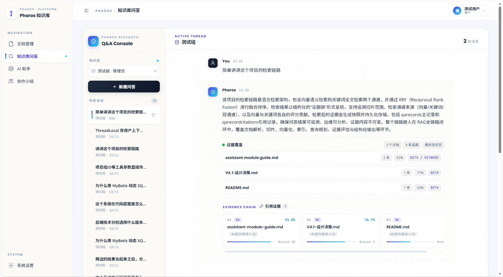
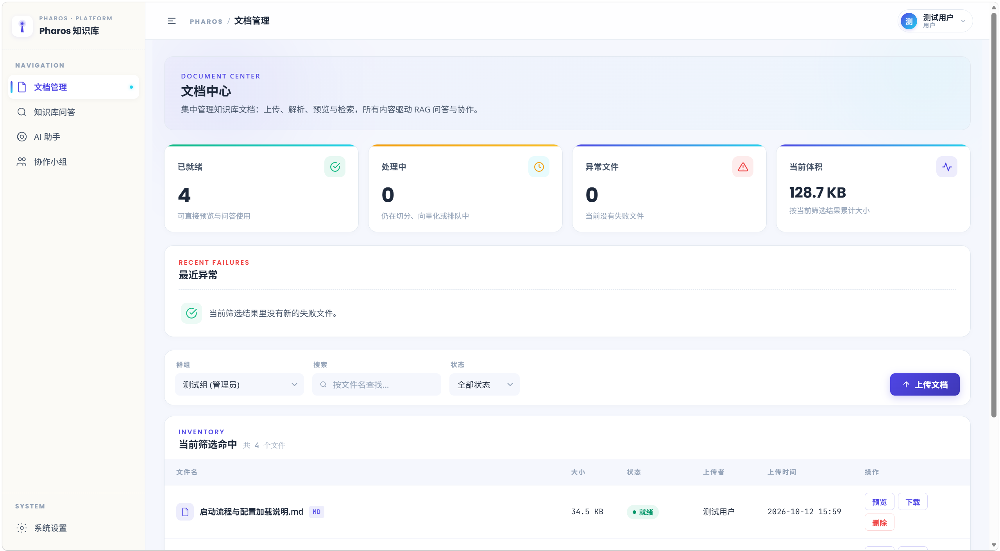
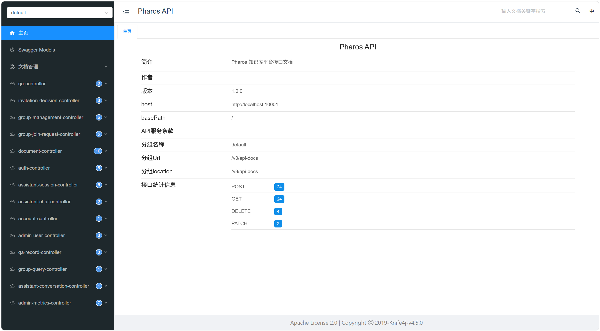
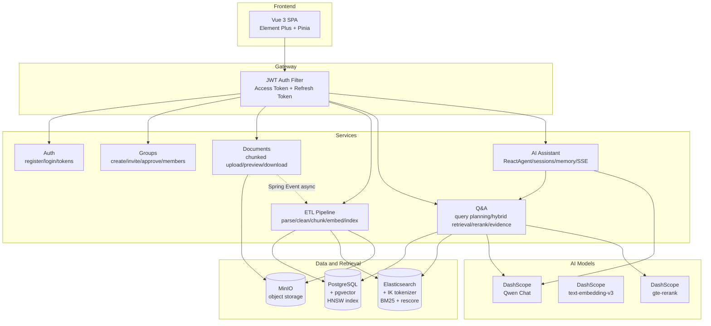

<div align="center">

<a href="README.md">简体中文</a> | <strong>English</strong>

<br/>
<br/>


<br/>
<br/>

# Pharos

**Knowledge Base Q&A System · Every Answer Accountable**

A complete Retrieval-Augmented Generation (RAG) pipeline — from document upload to cited answers

<br/>

[Overview](#overview) ·
[Screenshots](#screenshots) ·
[Core Pipeline](#core-pipeline) ·
[Architecture](#architecture) ·
[Features](#features) ·
[Tech Stack](#tech-stack) ·
[Quick Start](#quick-start) ·
[API](#api-overview) ·
[Version History](#version-history)

</div>

---

## Overview

**Pharos** is a knowledge base Q&A system built for enterprise private documents — turning knowledge scattered across PDFs, Word files and Markdown into answers that are **searchable, citable, and answerable to follow-up questions**.

It is not a thin wrapper over a general-purpose LLM. The full RAG pipeline is built from the ground up: **document parsing → structure-aware chunking → dual-channel indexing → hybrid retrieval → reranking → evidence grading → answer generation**. Every stage is independently observable and measurable.

> **About the name**
>
> Pharos was the Lighthouse of Alexandria, one of the Seven Wonders of the Ancient World. Built in the 3rd century BC at the entrance of the Alexandrian harbor, it lit the way for ships sailing at night.
>
> The Greek geographer Strabo recorded that the coastline there was "low-lying, featureless and full of reefs" — **a conspicuous landmark was required so that sailors could steer exactly to the harbor entrance**.
>
> An enterprise knowledge base faces the same situation: documents piled into a sea without signposts. Pharos aims to be that lighthouse — **illuminating the one passage worth reading out of the dark**.

### Problems It Solves

| Problem | How Pharos Responds |
| --- | --- |
| **Model hallucination** — LLMs confidently make things up | Answers must be grounded in retrieved passages; when evidence is insufficient, the system **declines to answer** |
| **Fragmented knowledge** — documents sit on disk, invisible to the model | Automatic parsing → chunking → embedding → indexing bridges "files" and "knowledge" |
| **Poor retrieval** — results come back, but the wrong ones | Dual-channel recall + fusion + **cross-encoder reranking**, with a self-built evaluation set to quantify quality |
| **No traceability** — no way to verify an answer | Every answer carries **citation snippets and source documents**, traceable one by one |
| **Stateless conversation** — every turn starts from zero | ReactAgent with three-tier short-term memory compression maintains cross-turn context |

---

## Screenshots

**Knowledge Base Q&A** — every answer carries a full citation chain: evidence coverage, plus each citation's relevance score and match channel (vector / keyword / both)



**Document Management** — status overview, multi-condition filtering, and the upload entry



**API Documentation** — Knife4j interactive console, 54 endpoints in total



---

## Core Pipeline

### 1. Ingestion: From Files to Searchable Knowledge

```
Upload → Parse → Chunk → Embed + Index → Searchable
```

- **Chunked upload protocol**: `init → chunk → complete`, with **resumable upload** and SHA-256 based **instant upload** (dedup); small files (≤10MB) take a direct path
- **Multi-format parsing**: PDF / DOCX / Markdown / TXT, with automatic encoding detection (GB18030 compatible)
- **Structure-aware chunking**: split along heading levels and paragraph boundaries, targeting 240 tokens with 32-token overlap — preserving semantic units instead of mechanical truncation
- **Dual-channel indexing**: each chunk is written to two engines —
  - **pgvector**: 512-dimension vectors + HNSW index + cosine distance
  - **Elasticsearch**: IK Chinese tokenization + BM25, with a two-stage `rescore` pass (`query_weight 0.2 : rescore_query_weight 1.0`)
- **Asynchronous ETL**: driven by Spring Event + `@Async`, made retryable via `@Retryable`, so documents never get stuck in processing

### 2. Retrieval: Dual-Channel Recall → Fusion → Reranking

**① Query planning (LLM)**

Each user question first passes through a planning layer that produces `{strategy, queries}`:

| Strategy | When | Behavior |
| --- | --- | --- |
| `DIRECT` | Question is already specific | Search with the original text |
| `REWRITE` | Question is colloquial | Rewrite into search-friendly phrases |
| `DECOMPOSE` | Compound question | Split into multiple sub-queries, retrieved sequentially |

**② Channel routing**

Sub-queries produced by rewriting take a **different route** from the original question: the original goes through both channels (vector + keyword), while sub-queries go through the **keyword channel only**.

> This reduces vector retrieval calls from **2.25 per question to 1** — a rewritten phrase is already close to a keyword string, so running an additional vector search adds cost with negligible benefit.

**③ Dual-channel recall and RRF fusion**

Results from both channels are fused with **RRF (Reciprocal Rank Fusion)**. RRF depends only on rank, not on scores, which sidesteps the fact that the two engines' scores are not comparable in scale.

**④ Cross-encoder reranking**

The fused candidate set then goes through a **cross-encoder reranker**: each "question + passage" pair is scored together, yielding finer relevance judgments than vector cosine similarity.

| Metric | Before | After |
| --- | --- | --- |
| **Chunk Top-5 hit rate** | 82.5 – 87.5% | **92.5%** |
| **MRR** (Mean Reciprocal Rank) | 0.69 | **0.813** |
| Latency cost | — | +286 ms |

**⑤ Context expansion**

Ranked chunks are expanded with a **neighbor window** (adjacent chunks on both sides), preventing answers from being cut apart at chunk boundaries.

> Verified by controlled experiment: disabling the neighbor window drops Chunk Top-5 hit rate by **7.5 percentage points** — beyond the evaluation noise floor (±2.5 points), which qualifies as a real change.

### 3. Answering: Evidence Grading and Citations

- **Four-level evidence sufficiency**: `NONE → WEAK → PARTIAL → SUFFICIENT`
  - Determined by which channels matched (`BOTH` / `VECTOR` / `KEYWORD`) plus normalized scores
  - When evidence is insufficient, the system **declines to answer** rather than letting the model improvise
- **Citation tracing**: every answer carries citation snippets, source documents and relevance scores, clickable back to the original text
- **Streaming output**: SSE delivers tokens incrementally, with a `token → citations → evidence-overview → record` event sequence

### 4. Agent: ReAct Tool Orchestration and Short-Term Memory

- **ReactAgent graph engine**: a `model decision → tool execution → result injection` loop, with a recursion limit to prevent runaway cycles
- **Two kinds of tool parameters**: model-decided (the query string) separated from code-injected (the permission identifier) — permissions are injected by the framework, never filled in by the model, **preventing privilege escalation in retrieval**
- **Single-retrieval constraint**: repeated tool calls return an instructional response that guides the model to terminate the chain
- **Three-tier short-term memory compression**: session summary → compact summary → runtime truncation, sustaining long conversations within a bounded context window

### 5. Quality Assurance: A Self-Built Evaluation Suite

A retrieval pipeline involves multiple recall paths and ranking stages. Any adjustment — embedding model, recall parameters, ranking strategy — needs a comparable baseline; otherwise there is no way to separate a real improvement from measurement noise. The project ships a reproducible evaluation process:

**40 paired questions**

| Design | Rationale |
| --- | --- |
| **20 keyword-style + 20 colloquial**, pairwise covering the same knowledge points | Distinguishes "**retrieval is wrong**" (both phrasings fail) from "**phrasing sensitivity**" (only the colloquial one fails) |
| **Grouped statistics** | Results can be broken down by question type and difficulty to localize problems |

**Parameter sweep**

Controlled experiments over tunable parameters (RRF fusion parameters, neighbor window):

| Parameter | Experiment | Conclusion |
| --- | --- | --- |
| Neighbor window | off / 1 / 2 | Off: **−7.5 points**; 2: no gain → **keep 1** |
| RRF fusion parameters | multiple configurations | Defaults are already optimal |

> **Known noise**: query planning calls an LLM, so rewritten phrases differ slightly between runs, producing a natural jitter of **±2.5 percentage points**. Only changes exceeding that are treated as real improvements.

---

## Architecture



---

## Features

### Authentication and Group Collaboration

- JWT dual tokens: Access Token (short-lived) + Refresh Token (httpOnly cookie with database rotation)
- Three-tier group roles (Owner / Manager / Member), invitation codes with an approval flow
- **Data isolation**: retrieval is filtered by group, preventing cross-group access

### Document Lifecycle

- Chunked upload / resumable upload / instant upload (dedup)
- Asynchronous ETL pipeline (7 fully automated steps, retryable on failure)
- Online preview, download, soft delete

### Knowledge Base Q&A

- LLM query planning (DIRECT / REWRITE / DECOMPOSE)
- Dual-channel retrieval + RRF fusion + cross-encoder reranking
- Four-level evidence grading, refusal mechanism, citation tracing

### AI Assistant

- ReactAgent graph engine with dynamic CHAT / KB_SEARCH mode switching
- Three-tier short-term memory compression, SSE streaming
- Persistent sessions with history

---

## Tech Stack

### Backend

| Layer | Technology | Version | Notes |
| --- | --- | --- | --- |
| Language | **Java** | 21 | Records, virtual threads, pattern matching |
| Framework | **Spring Boot** | 3.5.0 | Spring MVC, Jakarta EE 9+ |
| ORM | **MyBatis-Plus** | 3.5.15 | Lambda type-safe queries |
| Database | **PostgreSQL + pgvector** | 16+ | HNSW vector index, cosine distance |
| Search engine | **Elasticsearch** | 8.x | IK tokenizer, BM25 + rescore |
| Object storage | **MinIO** | latest | S3-compatible, multipart merge |
| AI chat | **Spring AI Alibaba** | 1.1.2.0 | DashScope integration (Qwen) |
| AI reranking | **DashScope Rerank** | 1.1.2.0 | Cross-encoder reranking |
| AI agent | **Spring AI Alibaba Agent** | 1.1.2.0 | ReactAgent graph engine |
| Auth | **JJWT** | 0.12.6 | HMAC-SHA256 |
| Password hashing | **Spring Security Crypto** | — | BCrypt |
| Document parsing | **PDFBox / POI** | 2.0.31 / 5.2.5 | PDF + DOCX text extraction |
| Retry | **Spring Retry** | — | Declarative `@Retryable` |
| API docs | **Knife4j + SpringDoc** | 4.5.0 | `/doc.html` with live testing |

### Frontend

| Layer | Technology | Version |
| --- | --- | --- |
| Language | **TypeScript** | 6.0 |
| Framework | **Vue 3** (Composition API) | 3.5 |
| Build | **Vite** | 8.0 |
| Routing | **Vue Router** | 5.0 |
| State | **Pinia** | 3.0 |
| UI components | **Element Plus** | 2.14 |
| HTTP | **Axios** | 1.16 |
| Markdown | **marked** | 18.0 |

### Infrastructure

| Component | Purpose |
| --- | --- |
| **PostgreSQL + pgvector** | Primary relational store + 512-dim vector index (HNSW / cosine) |
| **Elasticsearch 8.x** | IK tokenization + BM25 + two-stage rescore |
| **MinIO** | S3-compatible object storage, conditionally enabled |
| **DashScope** | Chat / Embedding / Rerank model services |

---

## Quick Start

### Requirements

| Component | Version | Notes |
| --- | --- | --- |
| **JDK** | 21 | Must support Records |
| **Node.js** | ≥ 20.19 | Frontend build |
| **PostgreSQL** | 16+ | Requires the `pgvector` extension |
| **Elasticsearch** | 8.x | Requires the IK tokenizer plugin |
| **MinIO** | latest | Object storage (can be disabled) |
| **DashScope API Key** | — | Shared by Chat / Embedding / Rerank |

### 1. Initialize Middleware

<details>
<summary><b>PostgreSQL + pgvector</b></summary>

```bash
# Install the pgvector extension
psql -h <host> -U <user> -d <database> -c "CREATE EXTENSION IF NOT EXISTS vector;"

# Apply the schema
psql -h <host> -U <user> -d <database> -f sql/schema.sql
```
</details>

<details>
<summary><b>MinIO (Docker)</b></summary>

```bash
docker run -d --name minio \
  -p 9000:9000 -p 9001:9001 \
  -e MINIO_ROOT_USER=minioadmin \
  -e MINIO_ROOT_PASSWORD=minioadmin \
  minio/minio server /data --console-address ":9001"

# Visit http://localhost:9001 and create a bucket (default: pharos-rag-documents)
```
</details>

<details>
<summary><b>Elasticsearch + IK tokenizer</b></summary>

```bash
docker run -d --name elasticsearch \
  -p 9200:9200 -p 9300:9300 \
  -e "discovery.type=single-node" \
  -e "xpack.security.enabled=false" \
  elasticsearch:8.x

# Install the IK tokenizer
docker exec -it elasticsearch bin/elasticsearch-plugin install \
  https://github.com/medcl/elasticsearch-analysis-ik/releases/download/v8.x/elasticsearch-analysis-ik-8.x.zip
docker restart elasticsearch
```
</details>

### 2. Configure

Edit `Pharos-backend/src/main/resources/application-local.yml`:

```yaml
# Database
spring.datasource.url: jdbc:postgresql://localhost:5432/pharos_rag
spring.datasource.username: your_username
spring.datasource.password: your_password

# LLM
spring.ai.dashscope.api-key: ${DASHSCOPE_API_KEY}
spring.ai.openai.api-key: ${DASHSCOPE_API_KEY}   # shares the same key

# Object storage (optional)
storage.minio.endpoint: http://localhost:9000
storage.minio.access-key: minioadmin
storage.minio.secret-key: minioadmin

# Elasticsearch
elasticsearch.host: localhost
elasticsearch.port: 9200
```

### 3. Start the Backend

```bash
export JAVA_HOME="/path/to/jdk-21"

cd Pharos-backend
./mvnw clean compile
./mvnw spring-boot:run

# API docs: http://localhost:10001/doc.html
```

### 4. Start the Frontend

```bash
cd Pharos-frontend
npm install
npm run dev

# Visit: http://localhost:5173
```

### Default Account

The development profile (`--spring.profiles.active=dev`) creates an admin account:

| Username | Password | Role |
| --- | --- | --- |
| `admin` | `admin123` | Administrator |

---

## API Overview

### Auth · `/api/auth`

| Method | Path | Description |
| --- | --- | --- |
| POST | `/api/auth/register` | Register |
| POST | `/api/auth/login` | Log in (returns Access + Refresh Token) |
| POST | `/api/auth/refresh` | Refresh token |
| POST | `/api/auth/logout` | Log out |
| GET | `/api/auth/me` | Current user |

### Groups · `/api/groups`

| Method | Path | Description |
| --- | --- | --- |
| POST | `/api/groups` | Create a group |
| GET | `/api/groups` | List visible groups |
| POST | `/api/groups/{id}/invitations` | Create an invitation |
| POST | `/api/groups/{id}/join-request` | Request to join |
| POST | `/api/groups/invitations/{id}/accept` | Accept an invitation |
| DELETE | `/api/groups/{id}/members/{userId}` | Remove a member |

### Documents · `/api/documents`

| Method | Path | Description |
| --- | --- | --- |
| POST | `/api/documents/upload/init` | Initialize chunked upload (dedup / resume detection) |
| POST | `/api/documents/upload/chunks` | Upload a chunk |
| POST | `/api/documents/upload/{id}/complete` | Complete upload, triggers ETL |
| POST | `/api/documents/upload` | Direct upload for small files (≤10MB) |
| GET | `/api/documents` | List documents |
| GET | `/api/documents/{id}/preview` | Preview |
| GET | `/api/documents/{id}/download` | Download |
| DELETE | `/api/documents/{id}` | Soft delete |

### Q&A · `/api/qa`

| Method | Path | Description |
| --- | --- | --- |
| POST | `/api/qa/ask` | Ask a question, returns an answer with citations |
| GET | `/api/qa/records` | Q&A history (paged / filtered by group) |
| GET | `/api/qa/records/{id}` | Record detail (with citation snippets) |
| DELETE | `/api/qa/records/{id}` | Delete a record |

<details>
<summary><b>Request / Response example</b></summary>

**Request**

```json
{
    "groupId": 1,
    "question": "What is the document upload flow? How do I retry a failed upload?"
}
```

**Response (excerpt)**

```json
{
    "answer": "Uploads use a three-stage chunked protocol...",
    "evidenceLevel": "SUFFICIENT",
    "retrievalSource": "BOTH",
    "citations": [
        {
            "fileName": "Pharos使用手册.pdf",
            "chunkText": "...",
            "score": 0.93
        }
    ]
}
```
</details>

### AI Assistant · `/api/assistant`

| Method | Path | Description |
| --- | --- | --- |
| GET / POST | `/api/assistant/sessions` | List / create sessions |
| PATCH / DELETE | `/api/assistant/sessions/{id}` | Rename / delete a session |
| POST | `/api/assistant/chat` | Synchronous chat (CHAT / KB_SEARCH) |
| POST | `/api/assistant/chat/stream` | Streaming chat (SSE) |
| GET | `/api/assistant/sessions/{id}/context` | Session context (with summary) |

---

## Project Structure

```
Pharos/
├── Pharos-backend/                          # Spring Boot backend
│   └── src/main/java/com/pharos/rag/
│       ├── auth/                            # Authentication (JWT dual tokens)
│       ├── user/                            # User management
│       ├── group/                           # Group collaboration
│       ├── document/                        # Document management
│       ├── ingestion/                       # ETL pipeline
│       │   └── service/pipeline/
│       │       ├── reader/                  #   Document readers
│       │       ├── parser/                  #   Multi-format parsers
│       │       └── transformer/             #   Cleaning + structure-aware chunking
│       ├── qa/                              # Knowledge base Q&A
│       │   └── rag/                         #   Hybrid retrieval + RRF + rerank
│       ├── assistant/                       # AI assistant
│       │   ├── agent/                       #   Agent factory + retrieval tool
│       │   ├── memory/                      #   Three-tier memory compression
│       │   └── service/                     #   Conversation orchestration
│       └── engine/                          # Infrastructure (ES / pgvector / MinIO)
│
├── Pharos-frontend/                         # Vue 3 frontend
│   └── src/
│       ├── api/                             # API wrappers
│       ├── views/
│       │   ├── documents/                   #   Document management
│       │   ├── qa/                          #   Knowledge base Q&A
│       │   ├── assistant/                   #   AI assistant
│       │   ├── groups/                      #   Groups
│       │   └── admin/                       #   User administration
│       ├── stores/                          # Pinia stores
│       └── components/                      # Shared components
│
├── docs/                                    # Project documentation
└── sql/
    └── schema.sql                           # Database DDL
```

---

## Version History

The project follows **incremental iteration**: each version focuses on a single theme, layering capabilities on top of one another.

| Version | Theme | Highlights |
| --- | --- | --- |
| **V1.0** | Foundations | Authentication (JWT dual tokens), group collaboration, project skeleton |
| **V2.0** | Document Engine | Chunked upload (resume / dedup), ETL pipeline, dual-path retrieval (vector + keyword) |
| **V3.0** | RAG Q&A | Query planning (LLM), RRF fusion, four-level evidence grading, citation tracing |
| **V4.0** | AI Agent | ReactAgent graph engine, CHAT / KB_SEARCH modes, three-tier memory, SSE streaming |
| **V5.0** | Retrieval Quality | Cross-encoder reranking, channel routing (2.25 → 1 vector call per question), 40-question paired evaluation set and parameter sweep |

> V5.0 improvements are backed by measured data: Chunk Top-5 hit rate **82.5–87.5% → 92.5%**, MRR **0.69 → 0.813**.
> See the [`docs/`](docs/) directory for design documents.

---

## Contributing

Issues and pull requests are welcome.

Before submitting a PR, please make sure:
- The code compiles (`./mvnw clean compile`)
- Existing code style and naming conventions are followed
- New features come with JavaDoc or explanatory comments

---

## License

This project is licensed under the [MIT License](LICENSE).

---

<div align="center">

**Pharos** · Knowledge Base Q&A System

Every answer accountable

</div>
