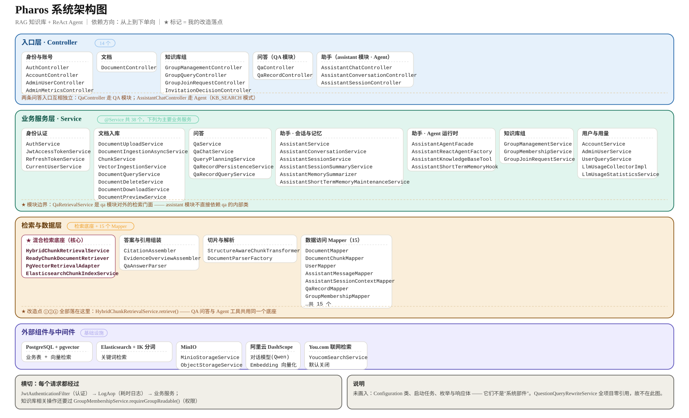
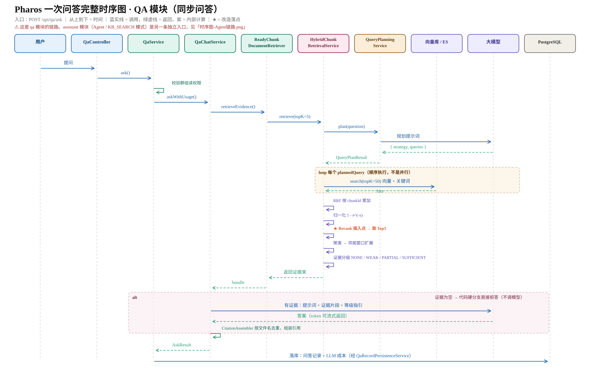

# Pharos 项目文档 V5.0

> V5.0 在 V4.1 的基础上，聚焦**检索质量**：把「双通道召回 → RRF 融合 → Rerank 精排」串成完整链路，
> 并建立 **40 题配对评测集**，让每次优化都有前后对照数据。

---

## 一、项目概述

### 1.1 V5.0 定位

V4.1 已经打通「文档上传 → 解析索引 → 混合检索 → 生成回答」的闭环，但检索侧还有两个缺口：

1. **质量不可度量**：改一个参数，不知道是变好还是变差；
2. **精排缺失**：RRF 只做粗排，候选池里真正相关的切片未必排在前面。

V5.0 的目标：把检索从「能用」做到「**可度量、可优化**」。

Rerank 精排在早期版本规划中提出，但此前版本未落地；V5.0 补齐，并做了对照实验。

### 1.2 V5.0 变更清单

| # | 变更 | 说明 | 结果 |
| --- | --- | --- | --- |
| 1 | 双通道混合检索 | pgvector（HNSW）+ ES（IK / BM25 / rescore）→ RRF 融合 | 语义与关键词互补 |
| 2 | Rerank 精排 | 交叉编码对候选逐条打分，精排后再截断 | Chunk Top5 **92.5%** |
| 3 | 查询规划与分通道 | DIRECT / REWRITE / DECOMPOSE；子查询只走关键词 | 向量调用 **2.25 → 1 次/题** |
| 4 | 40 题配对评测集 | 20 关键词型 + 20 口语型，两两覆盖同一知识点 | 每项优化有前后对照 |
| 5 | 参数对照实验 | RRF k、邻居窗口 | 确定默认值 |
| 6 | 证据分级与拒答 | 四级：NONE / WEAK / PARTIAL / SUFFICIENT | 证据不足不生成 |

### 1.3 当前系统能力

- 文档中心：分片上传 / 断点续传 / 秒传 / 多格式解析 / 结构感知切片
- 检索：查询规划 → 双通道召回 → RRF → 邻居窗口 → Rerank → 证据分级
- 问答：同步 / SSE 流式，带引用与证据概览
- Agent：ReAct 循环 + 知识库检索工具 + 短期记忆压缩
- 多租户：ThreadLocal 上下文 + MyBatis 动态 SQL 可见性过滤

---

## 二、技术栈

### 2.1 完整技术栈

| 层次 | 技术 |
| --- | --- |
| 语言 / 框架 | Java 21、Spring Boot 3.5、Spring AI Alibaba |
| 业务存储 | MySQL、MyBatis-Plus |
| 向量检索 | PostgreSQL + pgvector（HNSW） |
| 关键词检索 | Elasticsearch（IK 分词、BM25、rescore） |
| 对象存储 | MinIO |
| 前端 | Vue 3 + Element Plus |
| 部署 | Docker |

### 2.2 检索链路分层

```
Controller
   ↓
QaService（权限 + 当前用户）
   ↓
QaChatService（证据判断 + 生成 + 引用）
   ↓
ReadyChunkDocumentRetriever
   ↓
HybridChunkRetrievalService
   ├─ QueryPlanningService（LLM 规划）
   ├─ PgVectorRetrievalAdapter（向量召回）
   ├─ ElasticsearchChunkIndexService（关键词召回）
   ├─ RRF 融合 + 归一化
   ├─ 邻居窗口扩展
   ├─ Rerank 精排
   └─ selectRankedCandidates（截断）
```



> 服务级架构；检索链路的内部顺序见下方 QA 时序图。

---

## 三、项目结构

### 3.1 V5.0 涉及文件

| 文件 | 作用 |
| --- | --- |
| `qa/rag/HybridChunkRetrievalService.java` | 双通道召回、RRF、邻居窗口、Rerank、截断 |
| `qa/service/QueryPlanningService.java` | LLM 查询规划（策略 + 查询语句） |
| `qa/rag/ReadyChunkDocumentRetriever.java` | 把检索结果适配成 Spring AI `Document` |
| `engine/pgvector/PgVectorRetrievalAdapter.java` | 向量召回 |
| `engine/elasticsearch/ElasticsearchChunkIndexService.java` | 关键词索引与召回 |
| `qa/service/QaChatService.java` | 证据判断、结构化生成、引用组装 |
| `ingestion/service/EtlDocumentIngestionProcessor.java` | 解析、切片、双写 |
| `src/test/java/com/pharos/rag/eval/EvalRunner.java` | 评测入口 |
| `src/test/resources/eval/questions.json` | 40 题配对评测集 |

---

## 四、数据库设计

### 4.1 概述

V5.0 **未新增业务表**，检索链路复用现有结构：

| 存储 | 内容 |
| --- | --- |
| MySQL `document_chunks` | 切片正文、序号、文档 ID、群组 ID、元数据 |
| PostgreSQL + pgvector | 切片向量（HNSW 索引） |
| Elasticsearch | 切片倒排索引（IK + BM25 + rescore） |

### 4.2 检索相关约定

- 向量与 ES 文档都以 `chunkId` 为主键，重复写入是覆盖；
- 向量元数据包含 `groupId`、`documentId`、`chunkId`、`chunkIndex`；
- ES 过滤条件：`groupId + status=READY + deleted=false`。

---

## 五、核心设计决策

详见 [`V5.0-设计决策.md`](V5.0-设计决策.md)。本版本的关键决策：

1. 双通道混合检索与 RRF 融合；
2. Rerank 精排必须放在截断之前；
3. 查询规划与分通道；
4. 40 题配对评测集；
5. 四级证据分级与拒答。

---

## 六、API 接口

### 6.1 问答接口

| 方法 | 路径 | 说明 |
| --- | --- | --- |
| POST | `/api/qa/ask` | 同步问答 |
| POST | `/api/qa/stream-ask` | SSE 流式问答 |

V5.0 不改变接口形态，增强发生在检索链路内部：返回的引用、证据等级、`recordId` 保持不变。



### 6.2 评测入口

评测不对外暴露 HTTP 接口，通过 `EvalRunner` 直接调用 `HybridChunkRetrievalService.retrieve()`。

---

## 七、关键配置

### 7.1 检索参数

| 参数 | 值 | 说明 |
| --- | --- | --- |
| `CHANNEL_TOP_K` | 50 | 每个通道每路召回的候选数 |
| `RRF_K` | 0 | RRF 平滑常数 |
| `DEFAULT_NEIGHBOR_WINDOW` | 1 | 命中切片前后各扩 1 个 |
| 最终 TopK | 5 | 返回给生成的切片数 |

---

## 八、运行指南

### 8.1 评测集位置

`Pharos-backend/src/test/resources/eval/questions.json` —— 40 题，字段、指标与实验记录见 [评测报告](评测报告.md)。

### 8.2 运行评测

通过 `EvalRunner` 逐题调用检索、比对 `expectedDocumentId` / `expectedChunkIndexes`，输出：

- Doc Top1 / Doc Top5
- Chunk Top5
- MRR
- 平均耗时

支持按 `questionType`、`difficulty` 分组统计。

完整实验记录见 [评测报告](评测报告.md)。

---

## 九、后续版本规划

| 方向 | 说明 |
| --- | --- |
| 索引调优 | HNSW 的 `m` / `ef_construction` / `ef_search` 尚未系统调优 |
| 评测扩容 | 40 题样本偏小，后续扩充题型与语料 |
| 双写对账 | MySQL / pgvector / ES 三边对账，补缺删多 |
| 检索侧过滤 | 向量检索补充 `status / deleted` 过滤，与 ES 对齐 |
